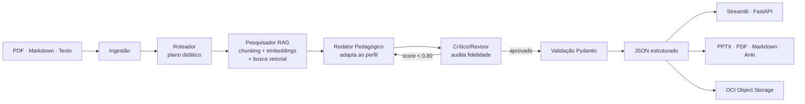

# 🧠 NovaMente

**Sistema Inteligente de Adaptação e Geração de Conteúdo Educacional**

Transforma documentação técnica densa em material didático personalizado —
flashcards, quizzes, tutoriais, resumos executivos e roteiros de aula — ancorado
nas fontes originais via RAG e orquestrado por agentes, com auditoria automática
contra alucinação.

> **Hackathon ONE G10 · Projeto 1** — Oracle Next Education & Alura
> Setor: EdTech / Treinamento Corporativo / Plataformas de Ensino Técnico

---

## O problema

Criar material didático a partir de documentação técnica complexa consome
semanas de especialistas e designers instrucionais. E um mesmo manual de
infraestrutura em nuvem precisa ser ensinado de formas muito diferentes para
quem está dando os primeiros passos em programação e para quem vai tomar
decisões executivas de investimento.

O NovaMente reduz esse ciclo de **semanas para menos de um minuto**, mantendo
fidelidade técnica ao documento de origem.

## O que ele faz

1. **Ingere** documentação técnica em PDF, Markdown ou texto bruto.
2. **Ancora** o conteúdo com um pipeline de RAG: segmentação em chunks,
   embeddings vetoriais e busca por similaridade em Vector Store.
3. **Orquestra quatro agentes** (Roteador → Pesquisador RAG → Redator Pedagógico
   → Crítico/Revisor) em um grafo de decisão com rodada de revisão.
4. **Audita a fidelidade** em duas camadas independentes, incluindo detecção
   determinística de números e identificadores inventados.
5. **Entrega** JSON estruturado, interface interativa e exportação em
   apresentação PowerPoint, PDF didático, Markdown e CSV compatível com Anki.
6. **Persiste** o documento original e o pacote gerado no **OCI Object Storage**
   (camada Always Free).

### Eixos de parametrização

| Eixo | Valores aceitos |
|---|---|
| **Perfil do destinatário** | Iniciante · Transição de Carreira · Desenvolvedor Júnior / Pleno · Líder Técnico / Arquiteto · Gestor / Executivo (Não Técnico) |
| **Formato pedagógico** | Flashcards · Quiz · Tutorial · Resumo Executivo · Roteiro de Aula |
| **Nicho / contexto** | Fintech · Saúde · E-commerce · Geral |
| **Nível de detalhe** | Didatico · Intermediario · Aprofundado |

---

## Arquitetura



O diagrama completo, o grafo de estados dos agentes e as decisões de projeto
estão em **[docs/arquitetura.md](docs/arquitetura.md)**.

### Mecanismo anti-alucinação

A fidelidade é verificada por dois mecanismos **independentes**, porque um LLM
auditando o próprio texto tende a aprová-lo:

- **Auditoria semântica (LLM):** o Agente Crítico compara cada afirmação com o
  contexto recuperado, sob critérios explícitos de pontuação.
- **Verificação léxica determinística:** mede a cobertura do vocabulário técnico
  na fonte e detecta **números órfãos** e **identificadores órfãos** — valores,
  siglas e comandos citados no material que não existem no documento original.

O score final é `0.65 × score_LLM + 0.35 × score_léxico`, e a camada léxica tem
**poder de veto**: números inventados limitam o resultado a 0.79, e três ou mais
limitam a 0.59, independentemente do que o LLM afirme.

---

## Stack

| Camada | Tecnologia |
|---|---|
| LLM | Google Gemini (`gemini-3.5-flash`) |
| Embeddings | `gemini-embedding-001` (3072 dimensões) |
| Orquestração | LangGraph + LangChain |
| Vector Store | ChromaDB (cosseno) |
| Ingestão de PDF | pypdf |
| Tipagem / validação | Pydantic v2 + pydantic-settings |
| API | FastAPI + Uvicorn |
| Interface | Streamlit |
| Exportação | python-pptx (apresentação), reportlab (PDF), csv (Anki) |
| Nuvem | OCI Object Storage — camada Always Free |
| Deploy | Railway (Docker) · OCI Compute Always Free |

---

## Instalação

Requer **Python 3.12 ou superior**.

```bash
git clone https://github.com/INASIOCS/Nova_Mente.git
cd Nova_Mente
```

```bash
python -m venv .venv
```

No Windows, ative com `.venv\Scripts\activate`; no Linux ou macOS, com
`source .venv/bin/activate`. Depois:

```bash
pip install -r requirements.txt
```

### Configuração

```bash
cp .env.example .env
```

Edite o `.env` e preencha a `GOOGLE_API_KEY` com uma chave do
[Google AI Studio](https://aistudio.google.com/apikey).

```ini
GOOGLE_API_KEY=sua_chave_aqui
GEMINI_MODEL=gemini-3.5-flash
GEMINI_EMBEDDING_MODEL=models/gemini-embedding-001

CHUNK_SIZE=1200
CHUNK_OVERLAP=150
TOP_K=5

STORAGE_BACKEND=local          # "local" ou "oci"
OCI_BUCKET_NAME=novamente-conteudos-educativos

AGENTE_ROTEADOR_ATIVO=true     # false economiza 1 chamada por execução
MAX_REVISOES=1                 # 0 desativa a rodada de revisão
LIMITE_REVISAO=0.80            # score de ancoragem que dispara a revisão
```

> O arquivo `.env` está no `.gitignore` e **nunca** deve ser commitado.

---

## Como executar

### Interface Streamlit

```bash
python -m streamlit run ui/app.py
```

Abre em `http://localhost:8501`. A interface permite upload de arquivo, colar
texto ou usar um dos documentos de exemplo em `docs/fontes/`, e mostra o rastro
completo do pipeline (chunks indexados, similaridade média, decisões de cada
agente).

### API REST

```bash
python -m uvicorn app.api.main:app --reload
```

Documentação interativa em `http://localhost:8000/docs`.

| Método | Rota | Descrição |
|---|---|---|
| `GET` | `/saude` | Diagnóstico de configuração (LLM, storage, bucket) |
| `GET` | `/opcoes` | Valores aceitos em cada eixo de parametrização |
| `POST` | `/adaptar` | **Endpoint principal** — adaptação de conteúdo |
| `POST` | `/adaptar/upload` | Adaptação a partir de upload de arquivo |
| `POST` | `/exportar/pptx` | Converte a resposta em apresentação PowerPoint |
| `POST` | `/exportar/markdown` | Converte a resposta em Markdown |
| `POST` | `/exportar/pdf` | Converte a resposta em PDF didático |
| `POST` | `/exportar/csv-anki` | Converte a resposta em CSV para Anki |

### Exemplo de requisição

```bash
curl -X POST http://localhost:8000/adaptar \
  -H "Content-Type: application/json" \
  -d '{
    "documento_titulo": "Introducao a Arquitetura de Redes VCN na OCI",
    "documento_conteudo": "A Virtual Cloud Network (VCN) e uma rede privada e personalizavel configurada na Oracle Cloud Infrastructure. Semelhante a uma rede de data center tradicional, a VCN oferece controle total sobre seu ambiente de rede, incluindo sub-redes publicas e privadas, tabelas de roteamento, Internet Gateways, NAT Gateways e Security Lists para controle de trafego via regras de entrada (ingress) e saida (egress).",
    "perfil_destinatario": "Iniciante",
    "formato_saida": "Flashcards",
    "nicho_setor": "Geral",
    "nivel_detalhe": "Didatico"
  }'
```

### Exemplo de resposta

```json
{
  "status": "sucesso",
  "metadados": {
    "perfil_aplicado": "Iniciante",
    "formato_gerado": "Flashcards",
    "tempo_estimado_estudo_minutos": 5,
    "conceitos_chave": ["VCN", "Sub-redes", "Internet Gateway", "Security Lists"],
    "pre_requisitos": []
  },
  "conteudo_adaptado": {
    "titulo": "Dominando Redes na Nuvem (VCN) do Zero",
    "introducao_contextualizada": "Imagine a VCN como o seu proprio bairro particular e seguro dentro da nuvem da Oracle, onde voce decide quem entra e quem sai.",
    "itens": [
      {
        "frente": "O que e uma VCN na Oracle Cloud?",
        "verso": "E a sua rede virtual privada e personalizada dentro da nuvem da Oracle, funcionando como a infraestrutura de rede da sua empresa.",
        "dica_didatica": "Pense nela como o terreno cercado onde seus servidores moram."
      }
    ]
  },
  "avaliacao_qualidade": {
    "ancoragem_fonte_score": 0.98,
    "clareza_pedagogica": "Alta",
    "observacoes": "Linguagem ajustada com analogias para publico iniciante, sem jargoes excessivos."
  },
  "armazenamento_oci": {
    "bucket": "novamente-conteudos-educativos",
    "objeto_id": "conteudos/vcn-iniciante-flashcards-a1b2c3.json",
    "status_upload": "concluido",
    "backend": "oci",
    "uri": "https://objectstorage.sa-saopaulo-1.oraclecloud.com/n/.../b/novamente-conteudos-educativos/o/..."
  }
}
```

---

## Demonstração

Os cenários de demonstração são gerados por um script e ficam versionados em
[`examples/`](examples/), em JSON (saída estruturada completa, com o rastro do
pipeline) e em Markdown (material pronto para leitura).

```bash
python scripts/gerar_exemplos.py          # todos os cenários
python scripts/gerar_exemplos.py 1 3      # apenas os cenários 1 e 3
```

Os cenários **1, 2 e 3 usam o mesmo documento** (a documentação de VCN da OCI),
adaptado para perfis e formatos diferentes — é a prova direta da capacidade de
adaptação exigida pelo checklist. Os cenários 4 e 5 exercitam os outros dois
formatos de ingestão (texto bruto e PDF).

### Resultados das execuções

Execuções reais registradas em 15/11/2026, com `gemini-3.5-flash` e embeddings
`gemini-embedding-001`:

| # | Documento | Ingestão | Perfil | Formato | Itens | Ancoragem | Clareza | Tempo |
|---|---|---|---|---|---|---|---|---|
| 1 | VCN | Markdown | Iniciante | Flashcards | 7 | **0.82** | Alta | 45,3s |
| 2 | VCN | Markdown | Líder Técnico / Arquiteto | Resumo Executivo | 5 | **0.81** | Alta | 53,5s |
| 3 | VCN | Markdown | Desenvolvedor Júnior / Pleno | Quiz | 5 | **0.82** | Alta | 38,3s |
| 4 | Object Storage | Texto bruto | Gestor / Executivo (Não Técnico) | Resumo Executivo | 5 | **0.73** | Alta | 144,9s |
| 5 | IAM | PDF | Desenvolvedor Júnior / Pleno | Tutorial | — | — | — | pendente de quota |

**Leitura dos resultados.** Os cenários 1, 2 e 3 provam o requisito central: o
mesmo documento de VCN gerou três materiais distintos, em três formatos, para
três perfis — de analogias para iniciantes a trade-offs de arquitetura.

O cenário 4 é o mais instrutivo. Sua ancoragem de **0.73** ficou abaixo do limite
de 0.80 e **disparou a rodada de revisão** do Agente Crítico, o que explica os
144,9s: foram cinco chamadas ao modelo em vez de três. O score permaneceu baixo
porque um resumo para público executivo necessariamente traduz termos técnicos em
linguagem de negócio, reduzindo a sobreposição léxica com a fonte. O mecanismo
funcionou como projetado: sinalizou o afastamento da fonte em vez de mascará-lo.

O cenário 5 não foi gerado porque a cota diária da API foi atingida (ver abaixo).
Para completá-lo, com a cota renovada:

```bash
python scripts/gerar_exemplos.py 5
```

> O checklist exige no mínimo **3** exemplos de execução; há **4** versionados.

### ⚠️ Limite de cota do Gemini (importante para a demonstração)

O free tier da API do Gemini permite cerca de **20 requisições de geração por
dia, por modelo**. O consumo do NovaMente por execução é:

| Configuração | Chamadas por execução |
|---|---|
| Completa (Roteador + Redator + Crítico) | 3 |
| Completa **com** rodada de revisão | 5 |
| Modo econômico (`AGENTE_ROTEADOR_ATIVO=false`, `MAX_REVISOES=0`) | 2 |

Isso significa cerca de **6 demonstrações ao vivo por dia** na configuração
completa. Para uma apresentação, há três recomendações:

1. Use os exemplos já versionados em `examples/` em vez de gerar ao vivo.
2. Ative o modo econômico no `.env` antes de demonstrar.
3. Reserve a geração ao vivo para um único cenário.

Ao estourar a cota, a API devolve `429` e o pipeline propaga uma mensagem de erro
explícita com o tempo de espera, em vez de falhar silenciosamente.

### Documentos técnicos de origem

| Arquivo | Formato | Tema |
|---|---|---|
| `docs/fontes/oci_vcn_arquitetura_de_redes.md` | Markdown | VCN, sub-redes, gateways, Security Lists e NSGs |
| `docs/fontes/oci_object_storage_conceitos.txt` | Texto bruto | Buckets, namespace, camadas, PARs e SDK |
| `docs/fontes/oci_iam_identidade_e_politicas.pdf` | PDF | Tenancy, compartimentos, políticas e principais |

---

## Oracle Cloud Infrastructure

### Object Storage (requisito obrigatório)

A persistência fica atrás de uma interface abstrata (`app/storage/base.py`) com
duas implementações selecionadas pela variável `STORAGE_BACKEND`:

- `oci` → **OCI Object Storage**, camada Always Free (produção).
- `local` → disco local, para desenvolvimento sem credenciais.

Para ativar o OCI:

1. No console da OCI, crie um bucket na camada Always Free (nome sugerido:
   `novamente-conteudos-educativos`), escopo *Namespace*, camada **Standard**,
   sem acesso público, com *auto-tiering* e versionamento desligados e
   criptografia gerenciada pela Oracle. Qualquer outra combinação pode sair da
   camada gratuita.
2. Gere um par de chaves de API em *Meu perfil → Tokens e chaves → Adicionar
   chave API*. A chave **privada** só pode ser baixada no instante da criação;
   se a janela fechar antes, a chave é inútil e precisa ser recriada.
   Alternativa mais segura: gerar o par localmente e usar *Colar chave pública*,
   que dispensa download.
3. Guarde a chave privada **fora da pasta do projeto** (ex.: `~/.oci/`) e
   configure `~/.oci/config` com `user`, `tenancy`, `fingerprint`, `key_file` e
   `region`.
4. No `.env`, defina `STORAGE_BACKEND=oci` e ajuste `OCI_BUCKET_NAME` e
   `OCI_REGION`. Deixar `OCI_NAMESPACE` vazio faz o código descobrir o namespace
   sozinho; preenchê-lo economiza uma chamada por execução.
5. Valide a cadeia inteira de uma vez:

   ```bash
   python scripts/verificar_oci.py
   ```

   O script confere, em ordem, o arquivo de configuração, a credencial, o
   namespace, o bucket e uma escrita/leitura real de um objeto de teste — que
   ele mesmo remove no fim. Ele para no primeiro elo quebrado e diz o que
   corrigir, sem imprimir segredos. Com `--criar-bucket`, cria o bucket caso
   ainda não exista.

6. Confirme pela API com `GET /saude?profundo=true`, que reporta o backend ativo
   e se o bucket responde. Sem `profundo`, o endpoint não toca na rede — ele é o
   healthcheck do deploy e a camada Always Free tem cota de requisições.

Quando a aplicação roda **dentro** da OCI, o código tenta automaticamente
autenticação por **Resource Principal**, dispensando chaves estáticas.

> ⚠️ **Aviso ONE:** o programa é uma iniciativa social 100% gratuita. Use
> **estritamente a camada Always Free** da OCI e evite qualquer configuração que
> possa gerar custo.

### Compute (diferencial)

O `Dockerfile` e o `entrypoint.sh` são agnósticos de plataforma: a mesma imagem
roda no Railway e em uma instância VM Linux Always Free da OCI. A variável
`SERVICE` escolhe o processo:

```bash
docker build -t novamente .
docker run -p 8080:8080 --env-file .env -e SERVICE=ui novamente    # interface
docker run -p 8080:8080 --env-file .env -e SERVICE=api novamente   # API REST
```

---

## Deploy

### Streamlit Community Cloud (link público da demonstração)

É o caminho usado para publicar a interface para a equipe e para a avaliação.
A nuvem do Streamlit instala o `requirements.txt` e executa `ui/app.py`.

1. Em <https://share.streamlit.io>, entrar com a conta do GitHub e autorizar o
   acesso ao repositório `INASIOCS/Nova_Mente`.
2. *Create app* → *Deploy a public app from GitHub*, com:
   - Repository: `INASIOCS/Nova_Mente`
   - Branch: `main`
   - Main file path: `ui/app.py`
   - URL: o subdomínio desejado (ex.: `nova-mente`).
3. Em *Advanced settings → Secrets*, colar o conteúdo de
   `.streamlit/secrets.toml.example` já preenchido. No mínimo a
   `GOOGLE_API_KEY`. **A chave é digitada pela pessoa responsável, nunca
   versionada.**
4. *Deploy*. O primeiro build leva alguns minutos (o SDK do OCI é grande).

Observações:

- Sem a seção `[oci]` nos *Secrets*, a aplicação grava em disco local e avisa na
  interface que o backend obrigatório não foi exercitado — o comportamento
  honesto já descrito acima.
- O disco da nuvem é efêmero: o que for salvo localmente some a cada reinício.
- A quota do Gemini é compartilhada por todos que abrirem o link. Para uma
  demonstração pública, vale ligar o modo econômico nos *Secrets*
  (`AGENTE_ROTEADOR_ATIVO = "false"` e `MAX_REVISOES = "0"`).

### Railway

O repositório já contém `Dockerfile` e `railway.json`. No painel do Railway:

1. Crie um projeto a partir deste repositório do GitHub.
2. Defina as variáveis de ambiente: `GOOGLE_API_KEY`, `SERVICE=ui` e, quando o
   OCI estiver configurado, `STORAGE_BACKEND=oci` e as variáveis `OCI_*`.
3. Para expor também a API REST, crie um segundo serviço no mesmo repositório
   com `SERVICE=api` e `healthcheckPath=/saude`.

A porta é lida de `$PORT`, como o Railway exige.

---

## Testes

```bash
pip install -r requirements-dev.txt
```

```bash
python -m pytest tests -v
```

A suíte cobre o contrato de dados (validando o exemplo oficial do briefing), a
segmentação do RAG, a verificação anti-alucinação e os exportadores. **Não
consome quota da API** — exercita apenas a lógica determinística.

---

## Estrutura do projeto

```text
app/
├── core/config.py          Configuração via .env
├── schemas/content.py      Contrato de entrada e saída
├── ingestion/loader.py     PDF, Markdown e texto
├── rag/                    chunking · embeddings · vector_store · retriever
├── agents/                 llm · prompts · fidelity · graph
├── storage/                base · local · oci_storage · factory
├── export/exporters.py     Markdown · PDF · CSV Anki
├── export/slides.py        Apresentação .pptx (layout institucional)
├── pipeline.py             Orquestração de ponta a ponta
└── api/main.py             FastAPI

ui/app.py                   Interface Streamlit (com quiz interativo)
docs/                       Arquitetura, briefing e documentos de origem
examples/                   Saídas das execuções de demonstração
scripts/                    Geração de exemplos e de PDFs de origem
tests/                      Suíte de testes
```

---

## Checklist de avaliação

| # | Requisito mínimo | Onde está |
|---|---|---|
| 1 | Ingestão de documentos técnicos (PDF, Markdown ou texto) | `app/ingestion/loader.py` · 3 formatos exercitados nos cenários |
| 2 | RAG com chunking, embeddings e busca vetorial | `app/rag/` · ChromaDB + `gemini-embedding-001` |
| 3 | Orquestração com LLM | `app/agents/graph.py` · LangGraph com 4 agentes |
| 4 | Mesmo conteúdo para ≥ 2 perfis e ≥ 2 formatos | Cenários 1, 2 e 3 — mesmo documento de VCN |
| 5 | JSON estruturado + interface interativa ou API REST | `app/schemas/content.py` · Streamlit **e** FastAPI |
| 6 | Integração com OCI Object Storage (Always Free) | `app/storage/oci_storage.py` |
| 7 | ≥ 3 exemplos de execução | `examples/` · 5 cenários |
| 8 | Documentação com diagrama de arquitetura | Este README · [docs/arquitetura.md](docs/arquitetura.md) |

### Diferenciais implementados

- ✅ **Sistema multi-agentes com LangGraph** — Roteador, Pesquisador RAG, Redator
  Pedagógico e Crítico/Revisor, com aresta condicional de revisão.
- ✅ **Quiz com avaliação em tempo real** — aba dedicada no Streamlit, com
  feedback explicativo imediato e placar de desempenho.
- ✅ **Exportação multiformato** — apresentação PowerPoint pronta para aula,
  PDF didático formatado, Markdown e CSV compatível com Anki.
- ⏳ **Deploy completo em nuvem OCI** — imagem Docker e instruções prontas;
  pendente de execução na instância Compute Always Free.

---

## Equipe

**Grupo 10 — Programa ONE (Oracle Next Education & Alura)**

Formações mapeadas: *Inteligência de Dados e RAG Avançado*, *Oracle Cloud
Infrastructure (OCI)*, *Engenharia de Agentes e Automação* e *Desarrollo y
Orquestación con IA Generativa*.

---

## Licença

Projeto acadêmico desenvolvido para o Hackathon ONE G10.
