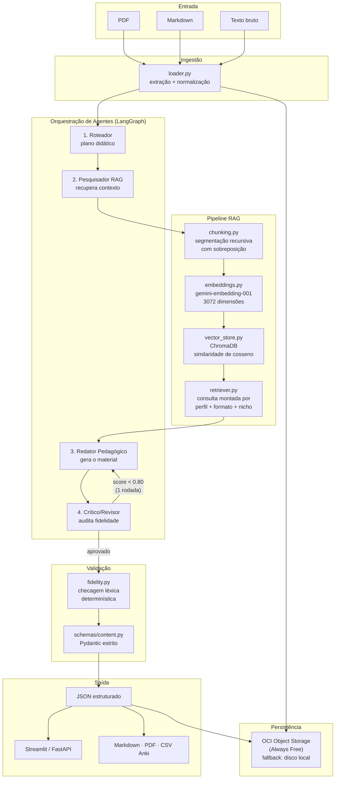
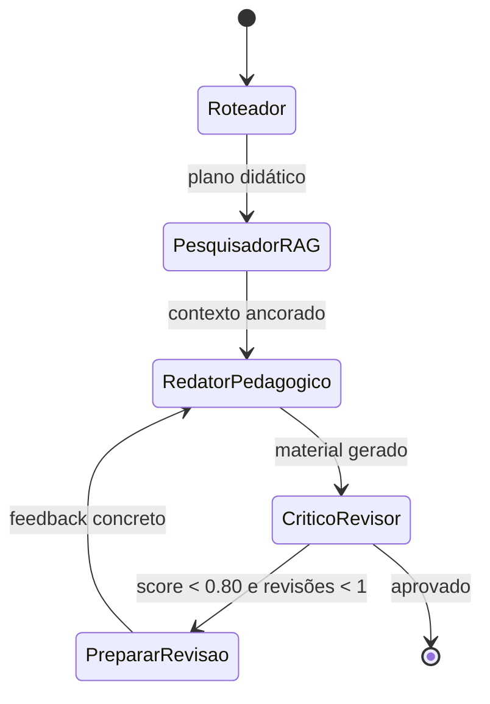

# Arquitetura da Solução — NovaMente

## 1. Visão geral

O NovaMente recebe um documento técnico, ancora o conteúdo em trechos reais
desse documento via RAG e orquestra quatro agentes para produzir material
didático adaptado a um perfil e a um formato pedagógico, com auditoria de
fidelidade à fonte antes da entrega.



## 2. Grafo de decisão dos agentes

O fluxo é um grafo com uma aresta condicional de retorno: o Agente Crítico pode
devolver o material ao Redator uma única vez, quando o score de ancoragem fica
abaixo de 0.80. O limite de uma rodada evita laço infinito e consumo
desnecessário de quota.



| Agente | Papel | Entrada | Saída |
|---|---|---|---|
| **Roteador** | Lê uma amostra do documento e define a estratégia didática | Documento + parâmetros | Assunto central, conceitos candidatos, pré-requisitos, riscos de adaptação |
| **Pesquisador RAG** | Executa chunking, embeddings e busca vetorial | Documento + eixos de parametrização | Top-k trechos com score de similaridade |
| **Redator Pedagógico** | Escreve o material no formato pedido, restrito ao contexto | Contexto + plano + perfil/formato/nicho/nível | Material em JSON |
| **Crítico/Revisor** | Audita alucinação e clareza; aprova ou devolve | Contexto + material | Score de ancoragem, clareza, feedback de revisão |

## 3. Mecanismo anti-alucinação (duas camadas)

A fidelidade à fonte é verificada por dois mecanismos independentes, e o score
final é a combinação dos dois. Isso importa porque um LLM auditando a si mesmo
tende a aprovar o próprio texto.

**Camada 1 — Auditoria semântica (LLM).** O Agente Crítico recebe o contexto de
origem e o material gerado e avalia, com critérios explícitos de pontuação, se
toda afirmação técnica se sustenta na fonte.

**Camada 2 — Verificação léxica determinística** (`app/agents/fidelity.py`).
Não depende do modelo e portanto não pode ser "convencida" por ele:

- **Cobertura de termos**: fração do vocabulário técnico do material que existe
  de fato no documento de origem.
- **Números órfãos**: valores numéricos citados no material que não aparecem na
  fonte. É a forma mais comum e mais perigosa de alucinação técnica — um limite
  de cota ou um número de porta inventado parece plausível e é falso.
- **Identificadores órfãos**: siglas, comandos e nomes de serviço inexistentes na
  fonte.

O score final é `0.65 × score_LLM + 0.35 × score_léxico`, com **poder de veto**:
a presença de números órfãos limita o resultado a 0.79 no máximo, e três ou mais
limitam a 0.59 — independentemente do que o LLM tenha dito. Números pequenos
(até 12) são ignorados, porque funcionam como ordinais e contagens didáticas.

## 4. Decisões de projeto

### Chunking recursivo com sobreposição
A segmentação respeita a maior fronteira semântica que couber (parágrafo, depois
linha, depois frase) em vez de cortar em um número fixo de caracteres. Cada chunk
recebe a cauda do anterior, de modo que uma definição técnica cortada na fronteira
continue recuperável.

### Consulta de recuperação derivada dos parâmetros
A consulta enviada ao Vector Store não é o título do documento: ela é montada a
partir do formato e do perfil pedidos. Um quiz precisa de fatos verificáveis, um
resumo executivo precisa de custo e risco, um tutorial precisa de passos. Buscar
o mesmo contexto para todos os formatos desperdiçaria a etapa de recuperação.

### Degradação explícita, nunca silenciosa
Cada camada tem um caminho de contingência, e o backend em uso é sempre
reportado no diagnóstico e na interface:

| Camada | Primário | Fallback |
|---|---|---|
| LLM | LangChain `ChatGoogleGenerativeAI` | SDK `google-generativeai` direto |
| Embeddings | `gemini-embedding-001` | Embedding léxico determinístico (hashing) |
| Vector Store | ChromaDB | Índice em memória com cosseno |
| Orquestração | LangGraph | Cadeia sequencial equivalente |
| Persistência | OCI Object Storage | Disco local |

O fallback de persistência **não** satisfaz o requisito obrigatório do edital:
quando ele entra em ação, o campo `status_upload` retorna `"local"` em vez de
`"concluido"`, e a interface exibe um aviso. A degradação fica visível em vez de
ser mascarada.

### Tipagem estrita por formato
Cada formato pedagógico tem um modelo Pydantic próprio (`ItemFlashcard`,
`ItemQuiz`, `ItemTutorial`, `ItemResumo`, `ItemRoteiro`). O quiz, por exemplo,
valida que `indice_resposta_correta` aponta para uma opção que existe — um erro
que o LLM comete e que passaria despercebido em um dicionário solto.

## 5. Estrutura de diretórios

```text
app/
├── core/config.py          Settings via pydantic-settings (.env)
├── schemas/content.py      Contrato de entrada/saída do briefing
├── ingestion/loader.py     PDF (pypdf), Markdown, texto
├── rag/
│   ├── chunking.py         Segmentação recursiva com sobreposição
│   ├── embeddings.py       Gemini + fallback léxico
│   ├── vector_store.py     ChromaDB + fallback em memória
│   └── retriever.py        Consulta por perfil/formato/nicho
├── agents/
│   ├── llm.py              Cliente Gemini (LangChain + SDK)
│   ├── prompts.py          Role prompting + few-shot por formato
│   ├── fidelity.py         Verificação léxica anti-alucinação
│   └── graph.py            Grafo LangGraph dos 4 agentes
├── storage/
│   ├── base.py             Protocolo StorageBackend
│   ├── local.py            Fallback em disco
│   ├── oci_storage.py      OCI Object Storage (Always Free)
│   └── factory.py          Seleção por STORAGE_BACKEND
├── export/exporters.py     Markdown, PDF didático, CSV Anki
├── pipeline.py             Orquestra tudo e monta a resposta
└── api/main.py             FastAPI

ui/app.py                   Interface Streamlit (inclui quiz interativo)
docs/fontes/                Documentos técnicos de origem (md, txt, pdf)
examples/                   Saídas das execuções de demonstração
scripts/                    Geração dos exemplos e dos PDFs de origem
tests/                      Testes do contrato, do RAG e da fidelidade
```

## 6. Fluxo de dados da persistência

Dois artefatos são gravados por execução:

1. `originais/<slug>-<hash>.<ext>` — o documento técnico enviado, preservado
   para rastreabilidade.
2. `conteudos/<slug>-<perfil>-<formato>-<hash>.json` — o pacote educacional
   gerado, acompanhado da requisição, dos metadados, da avaliação de qualidade e
   do rastro do pipeline.

O nome do objeto usa prefixos com barra, o padrão que o Object Storage
interpreta como hierarquia na console e que permite listagem por prefixo.
